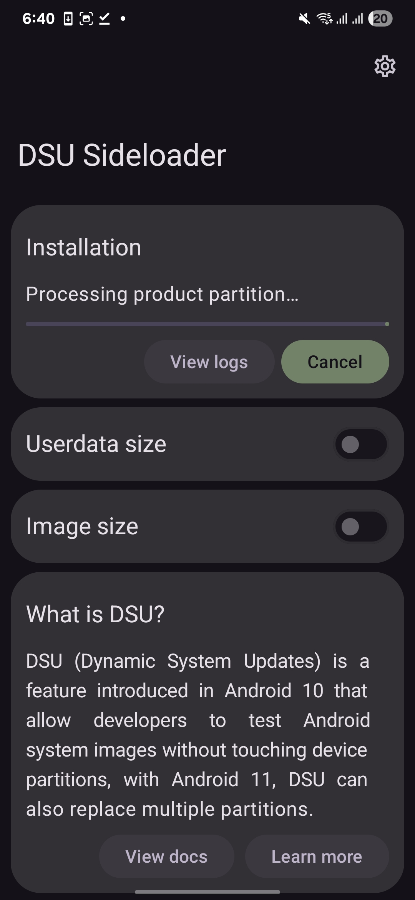
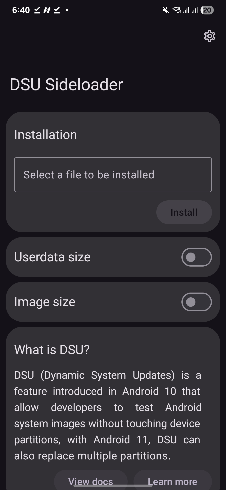

# DSU Sideloader

DSU Sideloader prepares Android system images and installs them with **Dynamic System Updates (DSU)**. DSU boots a Generic System Image (GSI) in temporary dynamic partitions, so you can try another Android build without replacing the device's normal system image.

> **This is an advanced Android tool.** A GSI can fail to boot or behave differently from your device's stock ROM. Keep a reliable way to restore your device and back up important data before experimenting.

<p align="center">
  
  &nbsp;&nbsp;
  
</p>

## Requirements

- Android 10 (API 29) or newer.
- A device that supports dynamic partitions and DSU.
- An unlocked bootloader for most third-party GSIs.
- A GSI that matches the device's CPU architecture and vendor interface.
- Temporary storage space for the selected image and any extracted files.

GSI references: [Android Generic System Images](https://developer.android.com/topic/generic-system-image/releases) · [Community GSI list](https://github.com/phhusson/treble_experimentations/wiki/Generic-System-Image-%28GSI%29-list)

## Download

- **Latest release:** [GitHub Releases](https://github.com/Knox-0x1-organization/DSU-Sideloader/releases/latest)
- **Development builds:** [GitHub Actions](https://github.com/Knox-0x1-organization/DSU-Sideloader/actions) (open a successful run and download its APK artifact)
- **F-Droid:** [DSU Sideloader](https://f-droid.org/packages/vegabobo.dsusideloader/)

Releases from this fork are debug-signed until a private release keystore is configured in the repository's GitHub Actions secrets. A debug-signed APK can be installed as a fresh app, but Android will not allow it to update an installation signed with a different key. The signing key must be controlled and backed up by the repository owner; never commit it to the repository.

## Install a GSI

1. Install and open DSU Sideloader.
2. Select or create an app storage folder and grant access. The app uses it for temporary files while preparing images.
3. Choose a supported image: `.img`, `.gz`, `.xz`, or a DSU package `.zip` (Android 11 and newer).
4. Optionally set a userdata size. Leave the image size automatic unless you have a specific reason to change it.
5. Start installation and follow the progress shown in the app. Use **View logs** to inspect, search, copy, or save installation activity and diagnostics.
6. Continue according to the selected operation mode below. When Android reports that DSU is ready, boot into it from the DSU notification or from the app when supported.

Installing a GSI does not replace the normal system partition. Rebooting normally returns to the device's original system unless sticky mode has been enabled in the running DSU.

## Operation modes

The app selects the most capable mode available; the mode cannot currently be selected manually.

| Mode | What it provides | What you need to do |
| --- | --- | --- |
| **ADB** | Prepares the image and creates the command needed to ask Android's DSU service to install it. | Run the displayed command from a computer with ADB, then confirm the installation on the device. |
| **Shizuku** | Uses Shizuku for the DSU request and can report progress and diagnose common failures. | Install and start [Shizuku](https://shizuku.rikka.app/), then authorize DSU Sideloader. Logcat diagnostics require the applicable log access permission. |
| **Root** | Adds DSU management actions and, where supported, the built-in installer. | Grant root access when prompted. |
| **System** | Provides privileged DSU access and includes the optional module's policy and `gsid` changes. | Install the DSU Sideloader Magisk module. |
| **System + Root** | Combines the system and root capabilities. | Install the module and grant root access. |

Some progress and diagnostic details depend on Android version and log access. The activity log still records the app's own preparation steps and built-in installer progress.

## Build with GitHub Actions

The repository builds APKs with GitHub Actions; no local Android SDK setup is needed to download a build.

1. Open the repository's [Actions page](https://github.com/Knox-0x1-organization/DSU-Sideloader/actions).
2. Select **Android CI**, then **Run workflow** to build the current `master` branch, or push a commit to start a build automatically.
3. Open a successful run and download the `dsu-sideloader-apk` artifact.

The build artifact includes `SHA256SUMS.txt`; verify an APK from the same downloaded artifact with `sha256sum -c SHA256SUMS.txt`.

To publish a versioned release, update `versionName` in the root `build.gradle.kts`, commit the change, then create and push a matching tag (for example, `v2.05` when the version is `2.05`). The workflow requires the tag to match the app version and attaches the APK and its SHA-256 checksum to a GitHub Release. Without signing secrets the release is marked as a prerelease and contains a debug-signed APK.

For updateable signed releases, configure these repository Actions secrets:

| Secret | Value |
| --- | --- |
| `DSU_KEYSTORE_BASE64` | Base64-encoded Android signing keystore. |
| `DSU_KEYSTORE_PASSWORD` | Keystore password. |
| `DSU_KEY_ALIAS` | Signing key alias. |
| `DSU_KEY_PASSWORD` | Key password; optional if it is the same as the keystore password. |

Keep a secure backup of the signing keystore and passwords. Replacing or losing the signing key prevents future APKs from updating existing installations signed with that key.

## Troubleshooting

- **The device does not support DSU:** Confirm that the ROM exposes DSU and uses dynamic partitions. Some vendor builds disable or alter DSU support.
- **The GSI does not boot:** Check that the image matches the device architecture and vendor interface. Verified Boot may reject an image; consult the device vendor's supported recovery instructions before changing boot verification settings.
- **The install reports low storage:** Free device storage and try again. Android's DSU service enforces its own allocation limits.
- **Allocation fails on removable storage:** Enable the app's SD unmount option, if available, and retry.
- **A permission or SELinux error appears:** Open **View logs**, save the diagnostics, and include them when reporting the issue. Avoid leaving SELinux permissive after troubleshooting.
- **The built-in installer is unavailable:** It requires root and is not supported on Android 10. Use another available operation mode.

## Reporting an issue

Open an [issue](https://github.com/Knox-0x1-organization/DSU-Sideloader/issues) and include:

- Device model, Android version, ROM, and operation mode.
- The image source, format, architecture, and approximate size.
- The exact error and the saved installation log, after reviewing it for information you do not want to share.
- Steps to reproduce the problem.

Do not attach private signing keys, passwords, or other credentials.

## About DSU

Dynamic System Updates let supported devices boot a GSI in temporary system partitions. Android provides a notification to boot the installed system; a normal reboot returns to the original system unless sticky mode is enabled. See the [Android DSU documentation](https://source.android.com/docs/core/ota/dynamic-system-updates) for platform details.

Sticky mode can be toggled from a shell while booted into the dynamic system:

```sh
adb shell gsi_tool enable
adb shell gsi_tool disable
```

## Credits and license

This project is based on [VegaBobo/DSU-Sideloader](https://github.com/VegaBobo/DSU-Sideloader). The optional module and custom `gsid` patches are in [`magisk-module`](magisk-module/). The app icon was made by [WSTxda](https://github.com/WSTxda). See [LICENSE](LICENSE) for the project license. Translations are coordinated through [Crowdin](https://crowdin.com/translate/dsu-sideloader/).
